# Lailo — Architecture

_Status as of 6 November 2026. Covers what is implemented today: passwordless sign-up / sign-in and the platform underneath it._

Lailo is an AI-first, ad-free e-commerce site: after signing in, the user gets a single chat box and the UI is rendered from predefined components based on what they ask. The chat experience is not built yet. This document describes the foundation that is: the system layout, the authentication flow, how data moves between stores, how security is enforced, and how it is all tested.

---

## 1. System at a glance

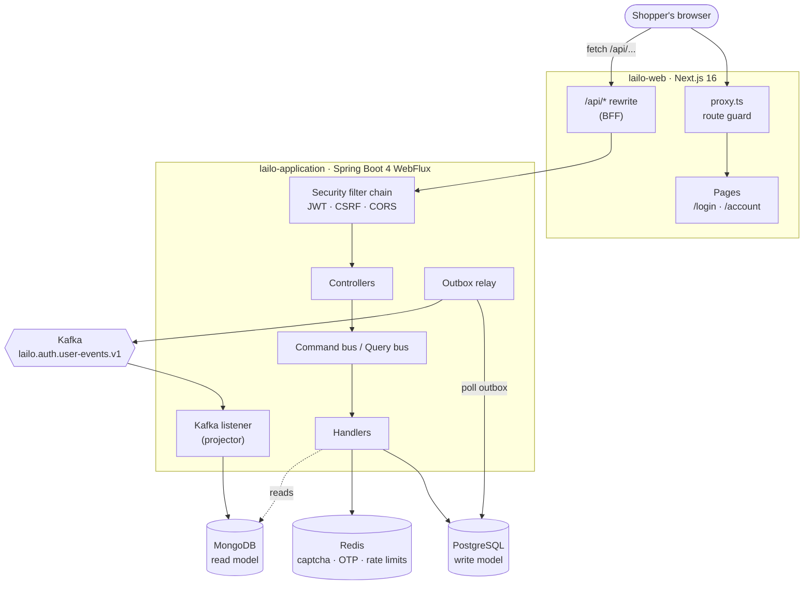

| Piece | Technology | Responsibility |
| --- | --- | --- |
| `lailo-web` | Next.js 16, React 19, Tailwind 4 | Sign-in UI, account page, route guarding, same-origin proxy to the API |
| `lailo-application` | Spring Boot 4.1 (WebFlux, Java 25) | Auth API, business rules, persistence, events |
| PostgreSQL 17 | R2DBC + Flyway | Source of truth: users, sessions, outbox |
| Redis | Reactive Lettuce | Short-lived state: captchas, OTP challenges, rate-limit counters |
| Kafka | spring-kafka | Integration events between the write and read sides |
| MongoDB | Reactive driver | Denormalised read model (`user_profiles`) |

Locally, all four services run as Homebrew services. Tests replace them with embedded instances (section 9).

---

## 2. Backend structure

The backend is organised **by feature**, and each feature is split into four layers. Dependencies point inwards only: the API knows the application layer, the application layer knows the domain and infrastructure interfaces, and the domain knows nothing about Spring.

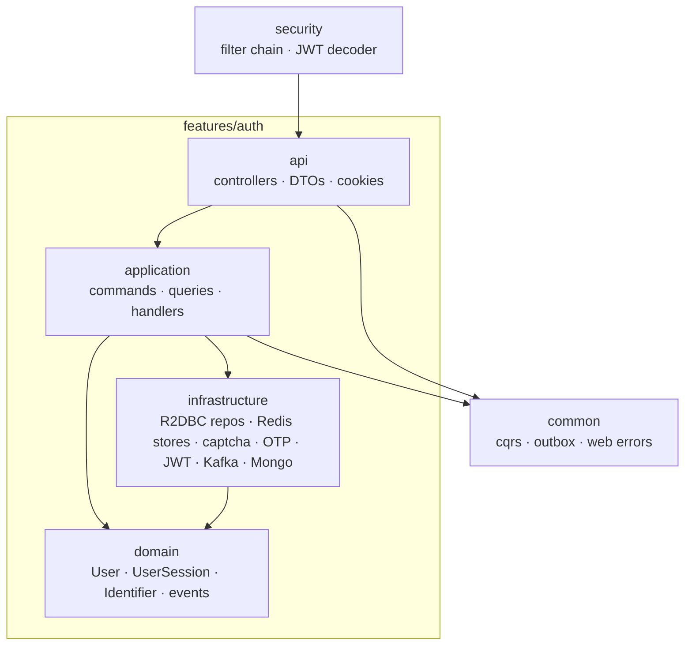

```
lailo-application/src/main/java/com/lailo/application
├── common
│   ├── cqrs        Command, Query, buses, handler registry
│   ├── outbox      OutboxMessage, OutboxPublisher, OutboxRelay
│   └── web         ApiException, ProblemDetail handler, ClientInfo
├── features
│   ├── auth        api · application · domain · infrastructure · config
│   └── product     (pre-existing sample feature)
├── observability   logging aspect
└── security        AuthConfig (filter chain, JWT encoder/decoder, CORS)
```

### 2.1 CQRS

Controllers contain no business logic. They turn an HTTP request into a **command** (changes state) or a **query** (reads state) and hand it to a bus. Each use case is exactly one handler class.

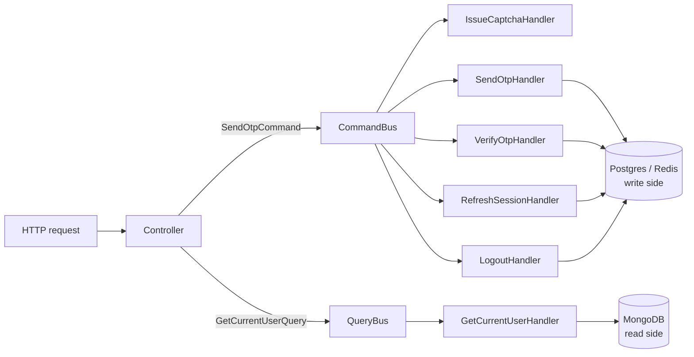

- Handlers register themselves by declaring the type they handle. The bus builds a type → handler index at startup and **fails fast on duplicates**.
- Everything is reactive (`Mono` / `Flux`) end to end; no thread blocks on I/O inside a request.
- New features add handlers. Nothing in the bus or controllers needs to change.

---

## 3. Sign-up / sign-in flow

There is one page and one flow for both new and returning users, as on Amazon or Flipkart. The user enters an **email or mobile number**, solves a captcha and receives a one-time code. Verifying the code signs them in; if no account exists, one is created at that moment.

### 3.1 Step 1 — captcha and send OTP

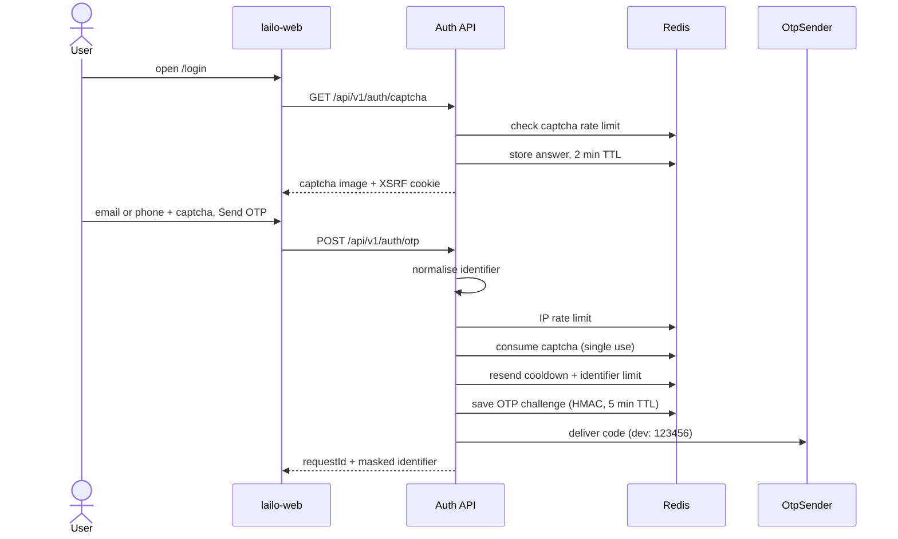

The order of checks is deliberate:

1. **IP throttle first.** It is cheap and protects everything behind it.
2. **Captcha before the per-identifier quota.** Otherwise a bot could exhaust a victim's OTP budget without solving anything.
3. **Same response for new and existing accounts.** Nobody can learn whether an email or number is registered.

### 3.2 Step 2 — verify OTP and sign in

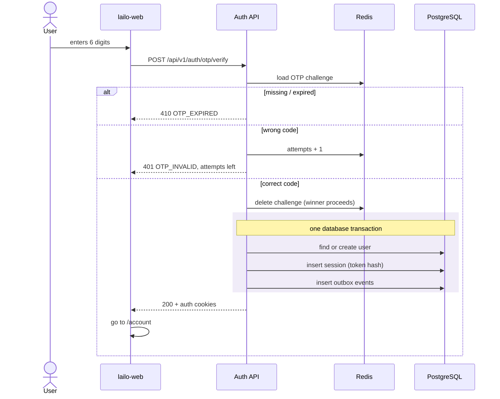

- **Single use under concurrency.** Two requests with the same correct code race on the Redis `DEL`; only the one that actually deletes the key continues. This is covered by a test that fires five parallel verifications and expects exactly one session.
- **Duplicate sign-up race.** Two simultaneous first sign-ins for the same identifier hit the unique index. The loser retries as a login.

### 3.3 Session lifecycle

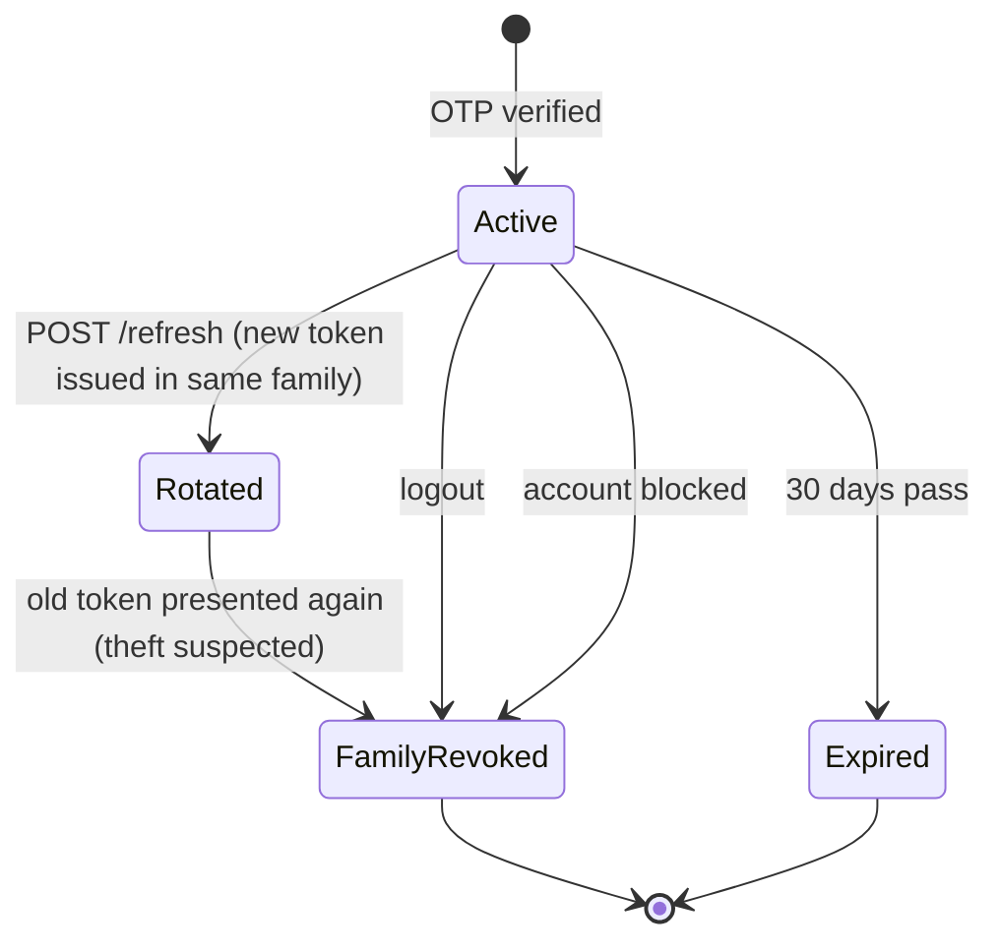

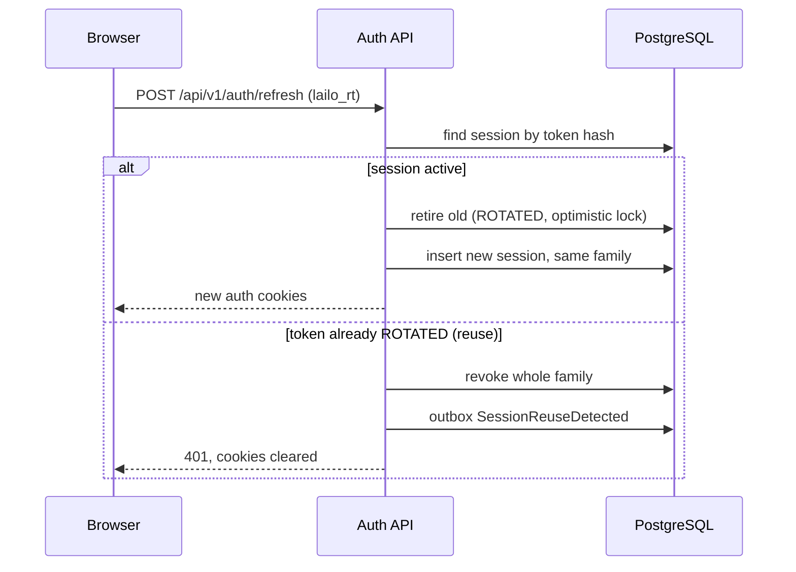

**Refresh-token rotation with reuse detection** (RFC 9700): every refresh retires the presented token. If a retired token ever comes back, someone has a copy. The whole family (every token descending from that one sign-in) is revoked, and the user signs in again. Other devices belong to other families and are unaffected.

---

## 4. Data architecture

### 4.1 PostgreSQL — write model

Schema is versioned with **Flyway** (`src/main/resources/db/migration`) and applied on startup.

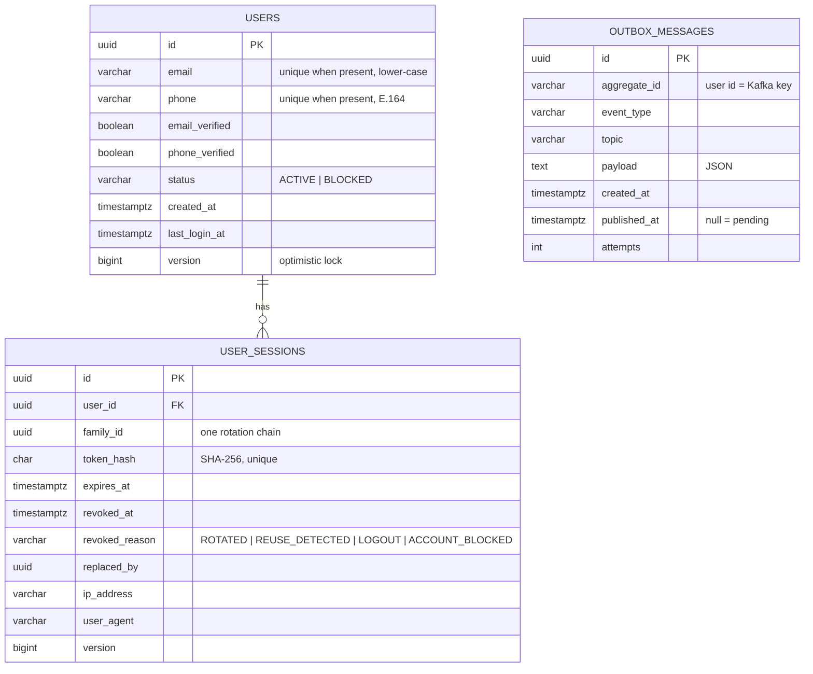

A user must have at least one of email or phone (check constraint). Raw refresh tokens are never stored.

### 4.2 Redis — ephemeral state

| Key | Type | TTL | Purpose |
| --- | --- | --- | --- |
| `captcha:{captchaId}` | string | 2 min | Expected answer; read with `GETDEL` so each captcha is tried once |
| `otp:req:{requestId}` | hash | 5 min | Identifier, HMAC-SHA256 of the code, attempt counter |
| `rl:otp:ip:{ip}` | counter | 15 min | Max OTP requests per IP per window |
| `rl:otp:id:{sha256(identifier)}` | counter | 15 min | Max OTP requests per identifier per window |
| `rl:cd:otp:{sha256(identifier)}` | flag | 30 s | Resend cooldown |
| `rl:captcha:ip:{ip}` | counter | 5 min | Captcha issuance per IP |

Identifiers are hashed in key names, so a Redis key dump contains no emails or phone numbers.

### 4.3 MongoDB — read model

`user_profiles` holds one document per user (`_id`, email, phone, registeredAt, lastLoginAt, lastLoginMethod), built only from events (section 5). It is what `GET /api/v1/users/me` reads.

---

## 5. Events: transactional outbox → Kafka → projection

Writing to Postgres and publishing to Kafka cannot be one atomic operation. Lailo uses the **transactional outbox** pattern: the event is written to `outbox_messages` in the *same* transaction as the state change, and a relay publishes it afterwards.

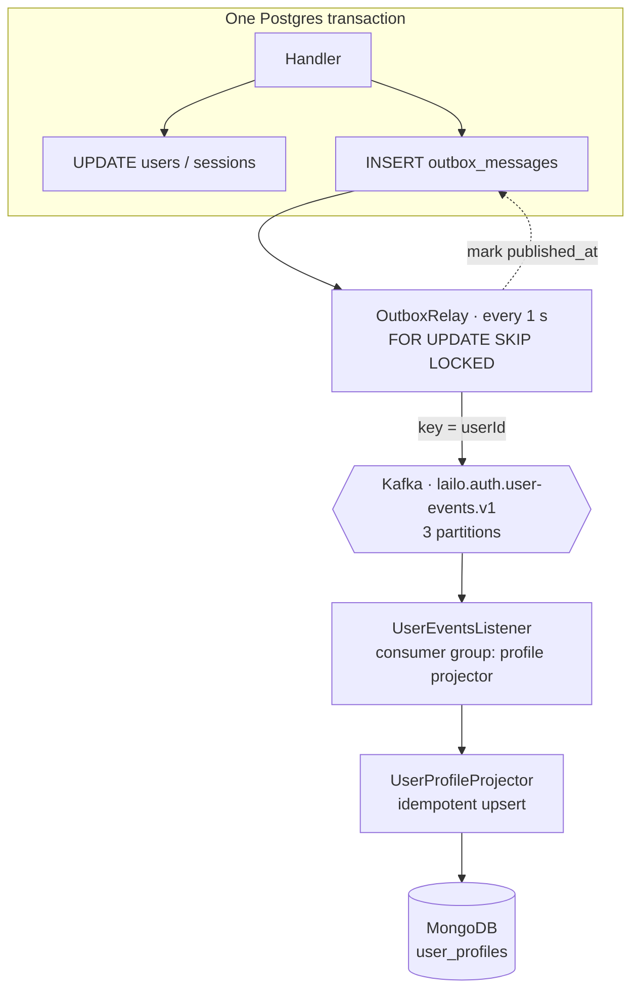

| Guarantee | How |
| --- | --- |
| No lost events | Event and state commit together; the relay retries until Kafka acknowledges (`acks=all`, idempotent producer) |
| No phantom events | A rolled-back transaction rolls back its outbox row too |
| Per-user ordering | Kafka key is the user id, so one user's events stay in one partition |
| Safe with many instances | `FOR UPDATE SKIP LOCKED` stops two relays sending the same row |
| Safe re-delivery | Projector uses `$setOnInsert`, `$min` / `$max` on timestamps; replays and out-of-order events converge to the same document |

**Eventual consistency.** The projection lags the write by about a second. Right after sign-up, `GetCurrentUserHandler` falls back to Postgres when the Mongo document does not exist yet, so the account page never shows an empty profile.

Events published today: `UserRegistered`, `UserLoggedIn`, `UserLoggedOut`, `SessionReuseDetected`.

---

## 6. Security architecture

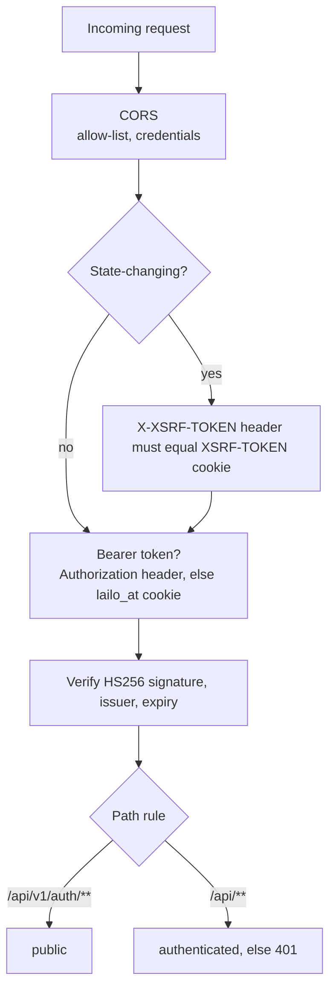

| Control | Implementation |
| --- | --- |
| Tokens | Access: JWT, HS256, 15 min, claims = user id, session id, roles (no PII). Refresh: 256-bit opaque, 30 days, rotated on every use |
| Cookies | Both `HttpOnly`. Access: `SameSite=Lax; Path=/`. Refresh: `SameSite=Strict; Path=/api/v1/auth`, sent only to refresh/logout. `Secure` everywhere except the dev profile |
| Token exposure | Tokens never appear in JSON bodies, so page JavaScript cannot read them |
| CSRF | Double-submit cookie on every POST/PUT/PATCH/DELETE |
| OTP storage | HMAC-SHA256 with a server key, bound to the request id; a 6-digit code cannot be brute-forced from a Redis dump |
| OTP abuse | 5-minute TTL, 5 attempts then burned, single use, 30 s resend cooldown, per-IP and per-identifier limits |
| Enumeration | Identical responses whether or not an account exists |
| Errors | RFC 9457 `ProblemDetail` with a stable `code` (e.g. `OTP_INVALID`, `RATE_LIMITED`); internal details never leak |
| Logs | Commands, requests and tokens override `toString()` so the debug logging aspect cannot print codes, tokens or full identifiers |
| Secrets | `LAILO_JWT_SECRET`, `LAILO_OTP_HASH_SECRET` and DB credentials come from the environment; startup fails without them outside the dev profile |

**Captcha** is a strategy interface with two implementations: a self-hosted image captcha (default; distorted text rendered server-side, answer held in Redis) and Cloudflare Turnstile (server-side verification implemented, widget not yet in the web app). Switching is configuration only (`LAILO_CAPTCHA_PROVIDER`). Turnstile verification **fails closed**: timeouts and errors count as "not human".

---

## 7. Frontend architecture

### 7.1 Backend-for-frontend

The browser only ever talks to the Next.js origin. `next.config.ts` rewrites `/api/*` to Spring Boot, so auth cookies are first-party and no CORS is involved in normal use.

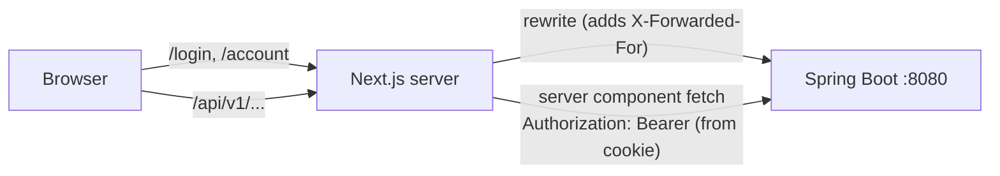

- **`proxy.ts`** (Next 16's replacement for middleware) does an optimistic check only: `/account` without an access cookie redirects to `/login?next=/account`; `/login` with one redirects to `/account`. Real authorisation always happens in the API.
- **`/account`** is a server component. It reads the access cookie, calls `/api/v1/users/me` with a bearer header, and streams in behind a `<Suspense>` boundary, as Cache Components requires.

### 7.2 The sign-in screen

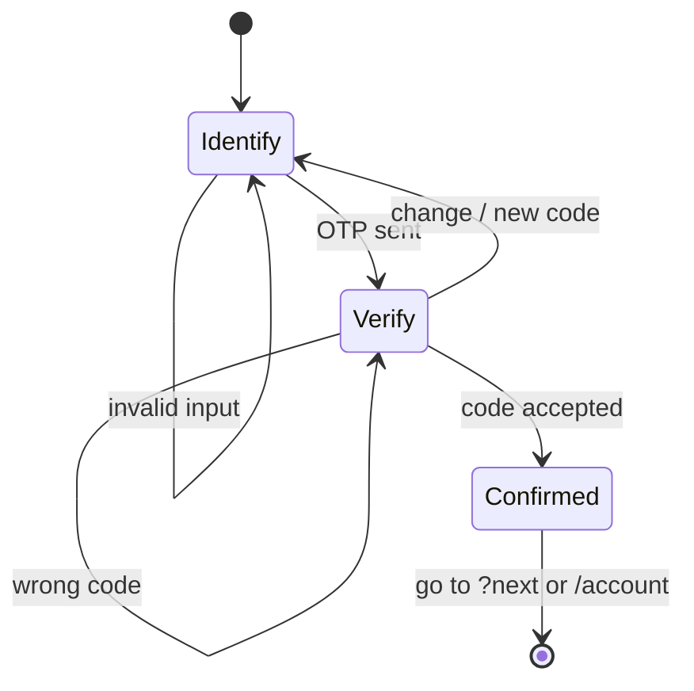

| Transition | What the user sees |
| --- | --- |
| Invalid input | Field-level message; on a wrong captcha a fresh image loads (each captcha is single use) |
| Wrong code | Cells clear, focus returns to the first cell, attempts left are shown |
| Change / new code | Back to step one with the identifier kept and a fresh captcha |
| Code accepted | Cells flash marigold, then navigation to `?next` (same-site paths only) or `/account` |

Notable details:

- **Client-side validation** mirrors the backend rules (`lib/identifier.ts`) for instant feedback; the server stays authoritative.
- **OTP input** is six cells acting as one field: typing advances, Backspace steps back, paste and SMS autofill (`autocomplete="one-time-code"`) fill every cell. A ref tracks the latest value so fast typing never drops digits.
- **Resend countdown** is deadline-based, so it stays correct when the browser throttles timers in background tabs.
- **API client** (`lib/api/client.ts`) echoes the CSRF cookie, maps problem responses to `ApiError` with the server's `code`, and on a 401 refreshes the session **once** (single-flight, shared by concurrent callers) before retrying.
- **Expired access, valid refresh.** The refresh cookie is path-scoped, so `proxy.ts` cannot see it. `/login?next=` therefore attempts a silent refresh before showing the form.
- **State hygiene.** With Cache Components, Next keeps visited pages alive (hidden) in React `<Activity>`. Sign-out does a full page load, and the sign-in form wipes itself after a successful sign-in, so one user's email or code never reappears for the next.

---

## 8. Configuration and environments

| Profile | Used by | Notable settings |
| --- | --- | --- |
| _(default)_ | Production / packaged jar | Secure cookies, no fixed OTP, all secrets required from the environment |
| `dev` | `./mvnw spring-boot:run` | OTP is always `123456`, insecure cookies for `http://localhost`, relaxed rate limits, debug logs |
| `test` | All backend tests | Fixed OTP, fast outbox polling, embedded MongoDB 7.0.15 version |

Settings are bound to a validated `AuthProperties` record, so an invalid value (for example a JWT secret shorter than 32 characters) stops the application at startup. `.env.example` files in both modules list every variable.

---

## 9. Testing architecture

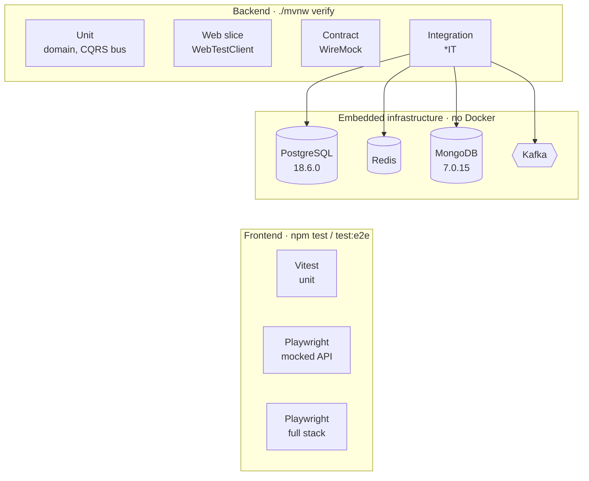

| Rule | Why |
| --- | --- |
| **Repositories and Redis stores are never mocked.** Handler tests run against the embedded databases | Mocks hide transactional behaviour. Switching to real databases immediately exposed a bug where a blocked user's session revocation was rolled back |
| Mockito only for true external boundaries (OTP delivery spy, buses in the web slice) | Keeps tests honest about what is ours versus third-party |
| Pinned embedded versions, guarded by `EmbeddedInfrastructureVersionIT` | A dependency bump cannot silently change the database version under test |
| One shared Spring context for all integration tests | Fast suite; tests isolate themselves with unique identifiers and IPs |
| Concurrency tests (parallel OTP verification, parallel refresh) | The security guarantees are only meaningful under races |

Current suite: 81 backend tests, 26 Vitest tests, 26 mocked Playwright tests, and 1 full-stack Playwright test.

---

## 10. Extension points

| Need | Where to plug in |
| --- | --- |
| SMS / email delivery | Provide an `OtpSender` bean (e.g. MSG91, Twilio, SES). `LoggingOtpSender` is only the dev fallback |
| Production captcha | `LAILO_CAPTCHA_PROVIDER=turnstile`, plus the widget in `CaptchaField` |
| Other services verifying JWTs | Move from HS256 to RS256/ES256 and publish a JWKS endpoint |
| New read models (orders, recommendations) | Consume `lailo.auth.user-events.v1` or new topics; the outbox works for any aggregate |
| Chat + generative UI | New feature package: a command that turns a prompt into a validated `[{component, props}]` spec, rendered by a component registry in `lailo-web` |

## 11. Known trade-offs

- **Two tabs refreshing at the same instant** may trigger reuse detection and sign the user out. The web client's single-flight refresh prevents this within one tab; a short grace window is a possible later addition.
- **HS256** suits a single backend; it becomes a liability once other services need to verify tokens.
- **The polling outbox relay** adds up to a second of latency. Change data capture (e.g. Debezium) is the scaling path.
- **The client IP** is taken from the first `X-Forwarded-For` hop, which is only trustworthy behind a proxy that overwrites that header.
